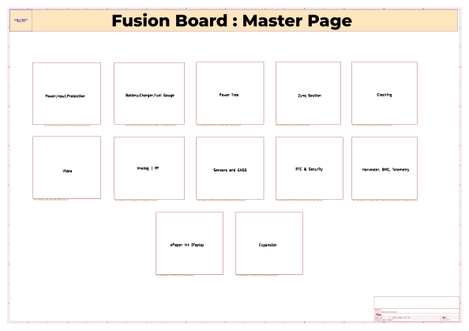

# Fusion Board

## 1. Project Overview

### What is Fusion Board ?

Fusion Board is an FPGA (Field Programmable Gate Array) built from scratch based on AMD Zynq Ultrascale + architecture.
This board features 4GB DDR4 RAM, 32GB Memory, E Ink Display and much more.
(*Note : Checkout Repo guide for repo navigation*)


### Goals and Objectives.

I designed this board to explore a new domain after making projects like [Flight controller](https://github.com/damnitzhemanth-oss/Flight_Controller/tree/main)
, [Calculator](https://github.com/damnitzhemanth-oss/Custom-Scientific-Calc).

### Key Features.


Zynq UltraScale+ XCZU4E,900-pin FBVB900 SoC with 4 GB DDR4 (4× MT40A512M16LY), 256 Mb QSPI, 32 GB eMMC, and microSD.
With High Speed connectivity Peripherals like SFP+ cage, PCIE, superspeed USB. There are 10 LDOs for different voltages such as +15V, +5V, +3V3, +2.5V, +1.8V, +0V9, +0V85.

On board barometer, GNSS, Gyro, magnetometer. With power harvester and a super capacitor for storing energy.

(*Note : There are many more amazing features, checkout [Features for Nerds](https://github.com/damnitzhemanth-oss/FusionBoard/blob/main/Guides/DetailsForNerds.md)
for detailed specs list.*)

---

## 2. Requirements

### Hardware Requirements 
(*Rough estimated prices according to LCSC, in $*)

| # | Reference | Qty | Value | LCSC Part | Subtotal (USD) |
|---:|:---|--:|:---|:---|--:|
| 1 | BT1 | 1 | Battery_Cell |  | 0.42 |
| 2 | C1,C3,C8 | 3 | 1uF |  | 0.02 |
| 3 | C2,C9,C15 | 3 | 100uF 35V |  | 0.33 |
| 4 | C4 | 1 | 100nF |  | 0.00 |
| 5 | C5,C10 | 2 | 1uF 25V |  | 0.01 |
| 6 | C6 | 1 | 2.2uF |  | 0.01 |
| 7 | C7,C26,C31,C412...C500 | 37 | 100nF |  | 0.10 |
| 8 | C11 | 1 | 0.1uF 50V X7R |  | 0.00 |
| 9 | C12,C13,C20 | 3 | 10nF 25V |  | 0.01 |
| 10 | C14,C81,C85,C111,C_shield1 | 5 | 4.7nF 50V |  | 0.01 |
| 11 | C16 | 1 | 2.2nF 25V |  | 0.00 |
| 12 | C17,C18,C66,C68,C70,C72,C74,C94,C105,C119 | 10 | 0.1uF 25V |  | 0.03 |
| 13 | C19,C21 | 2 | 0.1uF 50V |  | 0.01 |
| 14 | C22 | 1 | 47nF |  | 0.00 |
| 15 | C23,C24,C28,C29,C30,C50,C52,C60,C61,C64,C65 | 11 | 22uF |  | 0.31 |
| 16 | C25,C45,C48,C62,C101...C498 | 35 | 1uF |  | 0.10 |
| 17 | C27 | 1 | 4.7uF |  | 0.01 |
| 18 | C32,C33,C37 | 3 | 1uF |  | 0.02 |
| 19 | C34 | 1 | 0.47uF |  | 0.00 |
| 20 | C35,C39 | 2 | 10nF |  | 0.01 |
| 21 | C36,C58,C59,C63...C507 | 26 | 10uF |  | 0.29 |
| 22 | C38 | 1 | 0.1uF |  | 0.01 |
| 23 | C40 | 1 | 22uF, 6.3V |  | 0.03 |
| 24 | C41,C49 | 2 | 0.1uF, 25V |  | 0.01 |
| 25 | C42,C43,C82,C86,C103,C112,C477,C478,C495,C496 | 10 | 100pF |  | 0.03 |
| 26 | C44 | 1 | 10nF, 10V |  | 0.00 |
| 27 | C46,C79,C83,C109 | 4 | 10nF |  | 0.01 |
| 28 | C47 | 1 | 3.3nF |  | 0.00 |
| 29 | C51 | 1 | 2.2nF |  | 0.00 |
| 30 | C53,C54,C55,C56 | 4 | 47uF,4V |  | 0.22 |
| 31 | C57,C97,C99,C107,C113 | 5 | 47uF |  | 0.28 |
| 32 | C76,C78,C104 | 3 | 0.1uF 25v |  | 0.01 |
| 33 | C77,C121...C523 | 300 | 0.1uF |  | 0.83 |
| 34 | C80,C84,C91,C96,C110,C118 | 6 | 22uf 25v |  | 0.21 |
| 35 | C87,C88,C114,C481,C482 | 5 | 22pF |  | 0.01 |
| 36 | C89,C90,C92,C93,C115,C116 | 6 | 47uF 6.3V |  | 0.33 |
| 37 | C154,C174 | 2 | 47uF |  | 0.17 |
| 38 | C368,C369,C370,C380,C381,C382,C383,C392,C422 | 9 | 1nF |  | 0.03 |
| 39 | C372,C373,C408,C409 | 4 | 33pF |  | 0.01 |
| 40 | C375,C385 | 2 | 22uF |  | 0.03 |
| 41 | C424,C429,C431 | 3 | 10uF |  | 0.06 |
| 42 | C473 | 1 | 0.56 nF |  | 0.00 |
| 43 | C474 | 1 | 330 nF |  | 0.00 |
| 44 | C475 | 1 | 3.3 nF |  | 0.00 |
| 45 | C499 | 1 | 0.1 uF |  | 0.00 |
| 46 | C518 | 1 | 22F 5.5V |  | 1.11 |
| 47 | Card1 | 1 | TF-01A | C91145 | 0.17 |
| 48 | CN1 | 1 | 1-2199230-6 | C4710843 | 1.39 |
| 49 | D1 | 1 | SMBJ20A |  | 0.08 |
| 50 | D2 | 1 | 15V |  | 0.08 |
| 51 | D3 | 1 | TP7.OSMD24CA-XC |  | 0.11 |
| 52 | D4 | 1 | LSMB24CAH |  | 0.11 |
| 53 | D5 | 1 | Red |  | 0.01 |
| 54 | D6,D9 | 2 | Green |  | 0.03 |
| 55 | D7,D8 | 2 | D_Schottky |  | 0.14 |
| 56 | D10,D11,D12 | 3 | RB521S30 |  | 0.08 |
| 57 | DC1 | 1 | PJ-102AH_C3096093 | C3096093 | 0.60 |
| 58 | FB1,FB2,FB3,FB4,FB5,FB6,FB7,FB8,FB10 | 9 | 120Ω@100MHz |  | 0.06 |
| 59 | FB9 | 1 | BLM18 |  | 0.01 |
| 60 | J1 | 1 | HR911105A_C12074 | C12074 | 1.35 |
| 61 | J2 | 1 | Conn_01x03_Pin |  | 0.14 |
| 62 | J3 | 1 | USB3_B |  | 1.11 |
| 63 | J4,J5 | 2 | Conn_01x02_Pin |  | 0.22 |
| 64 | J6 | 1 | 3.3V_I2C |  | 0.11 |
| 65 | J7,J14,J15,J16 | 4 | Conn_01x10 |  | 0.83 |
| 66 | J8 | 1 | Conn_01x09_Pin |  | 0.19 |
| 67 | J9 | 1 | Conn_Coaxial |  | 1.39 |
| 68 | J10 | 1 | Conn_02x07_Odd_Even |  | 0.28 |
| 69 | J11 | 1 | Conn_01x04_Pin |  | 0.14 |
| 70 | J12 | 1 | SFP+ |  | 2.08 |
| 71 | J13 | 1 | Conn_01x22 |  | 1.11 |
| 72 | L1,L2 | 2 | 2.2uH,5A |  | 0.42 |
| 73 | L3 | 1 | 1/2.2uH |  | 0.21 |
| 74 | L4 | 1 | 0.47uH 15A |  | 0.28 |
| 75 | L5 | 1 | 10uH 12A |  | 0.28 |
| 76 | L6,L7 | 2 | 2.2uH |  | 0.42 |
| 77 | L8,L9,L10 | 3 | 1uH |  | 0.42 |
| 78 | L11 | 1 | DLW21HN900SQ2L-CUTTAPE | C80529 | 0.14 |
| 79 | L12,L13,L14 | 3 | 220 nH |  | 0.13 |
| 80 | Q1,Q2 | 2 | IPB180P04P4L-02 | C21547650 | 2.22 |
| 81 | R1,R3,R135,R138,R163,R164 | 6 | 5.1kΩ |  | 0.01 |
| 82 | R2,R13,R41,R49,R50,R52,R54,R56,R59,R153,R155,R165,R166 | 13 | 100kΩ |  | 0.02 |
| 83 | R4,R7,R20,R21,R22,R23,R24,R29,R75 | 9 | 10k |  | 0.01 |
| 84 | R5 | 1 | 100Ω |  | 0.00 |
| 85 | R6,R8,R177,R178,R181 | 5 | 4.7kΩ |  | 0.01 |
| 86 | R9,R25 | 2 | 124k |  | 0.00 |
| 87 | R10,R27,R34...R212 | 54 | 10kΩ |  | 0.08 |
| 88 | R11,R12,R60,R65,R70,R73,R74,R76,R78,R90,R101 | 11 | 100k |  | 0.02 |
| 89 | R14 | 1 | 549Ω |  | 0.00 |
| 90 | R15,R26 | 2 | 750Ω |  | 0.00 |
| 91 | R16,R17 | 2 | 470R |  | 0.00 |
| 92 | R18 | 1 | 29.8k |  | 0.00 |
| 93 | R19,R92 | 2 | 120k |  | 0.00 |
| 94 | R28 | 1 | 5.9kΩ |  | 0.00 |
| 95 | R30 | 1 | 442k |  | 0.00 |
| 96 | R31 | 1 | 210k |  | 0.00 |
| 97 | R32 | 1 | 20.5k |  | 0.00 |
| 98 | R33 | 1 | 10mΩ |  | 0.69 |
| 99 | R37,R48,R104,R105,R140,R145 | 6 | 1kΩ |  | 0.01 |
| 100 | R38 | 1 | 1k |  | 0.00 |
| 101 | R39 | 1 | 100 |  | 0.00 |
| 102 | R40 | 1 | 180Ω |  | 0.00 |
| 103 | R42 | 1 | 30.1kΩ |  | 0.00 |
| 104 | R45 | 1 | 5.23kΩ |  | 0.00 |
| 105 | R55 | 1 | 31.6K |  | 0.00 |
| 106 | R58 | 1 | 60.4k |  | 0.00 |
| 107 | R63 | 1 | 49.9k |  | 0.00 |
| 108 | R64 | 1 | 24.3kΩ |  | 0.00 |
| 109 | R67,R183,R187 | 3 | 10Ω |  | 0.00 |
| 110 | R69 | 1 | 73.2kΩ |  | 0.00 |
| 111 | R71 | 1 | 249kΩ |  | 0.00 |
| 112 | R72 | 1 | 309k |  | 0.00 |
| 113 | R77 | 1 | 200k |  | 0.00 |
| 114 | R81,R82 | 2 | 49.9kΩ |  | 0.00 |
| 115 | R85,R87,R99 | 3 | 20k |  | 0.00 |
| 116 | R86,R89,R100 | 3 | 50K |  | 0.00 |
| 117 | R88 | 1 | 182kΩ |  | 0.00 |
| 118 | R91,R93,R102 | 3 | 249k |  | 0.00 |
| 119 | R94 | 1 | 3.24kΩ |  | 0.00 |
| 120 | R95 | 1 | 14.7kΩ |  | 0.00 |
| 121 | R103 | 1 | 220Ω |  | 0.00 |
| 122 | R106,R107,R108,R109 | 4 | 240Ω |  | 0.01 |
| 123 | R110,R112,R122,R125...R139 | 11 | 22Ω |  | 0.02 |
| 124 | R124 | 1 | 11kΩ |  | 0.00 |
| 125 | R129,R132 | 2 | 470Ω |  | 0.00 |
| 126 | R137 | 1 | 8.06kΩ |  | 0.00 |
| 127 | R142,R144 | 2 | 2.49kΩ |  | 0.00 |
| 128 | R146 | 1 | 47.5kΩ |  | 0.00 |
| 129 | R147 | 1 | 22.1kΩ |  | 0.00 |
| 130 | R148,R167,R176,R209,R210 | 5 | 1MΩ |  | 0.01 |
| 131 | R149,R150,R152,R156,R157,R159,R160,R199,R200 | 9 | 2.2kΩ |  | 0.01 |
| 132 | R154 | 1 | 200kΩ |  | 0.00 |
| 133 | R161 | 1 | 12kΩ |  | 0.00 |
| 134 | R168,R175,R186,R192,R193,R195 | 6 | 50Ω |  | 0.01 |
| 135 | R169,R171 | 2 | 33Ω |  | 0.00 |
| 136 | R182,R184,R185 | 3 | 27Ω |  | 0.00 |
| 137 | R191 | 1 | 1.92kΩ |  | 0.00 |
| 138 | R196,R197,R201,R202,R203,R204,R205,R206 | 8 | 5kΩ |  | 0.01 |
| 139 | R208 | 1 | 4.02MΩ |  | 0.00 |
| 140 | R211 | 1 | 3MΩ |  | 0.00 |
| 141 | RT1 | 1 | 10k NTC |  | 0.04 |
| 142 | R_shield1 | 1 | 1 M |  | 0.00 |
| 143 | SW1 | 1 | SW_Push |  | 0.21 |
| 144 | SW2 | 1 | SW_SPDT |  | 0.28 |
| 145 | TP1,TP2 | 2 | TestPoint |  | 0.14 |
| 146 | U1 | 1 | TPD6S300ARUKR | C2876380 | 0.51 |
| 147 | U2 | 1 | STUSB4500QTR |  | 2.08 |
| 148 | U3 | 1 | TVS2201DRBR | C1849889 | 0.21 |
| 149 | U4,U6 | 2 | TPS259470ARPWR | C3662799 | 10.34 |
| 150 | U5 | 1 | TPS2121RUXR | C485916 | 0.53 |
| 151 | U7 | 1 | XT60 | C98733 | 0.28 |
| 152 | U8 | 1 | DW06 | C917080 | 0.07 |
| 153 | U9 | 1 | BQ25895RTWR | C80200 | 2.17 |
| 154 | U10 | 1 | BQ27441DRZR-G1A | C473397 | 1.41 |
| 155 | U11 | 1 | LM66100DCK |  | 0.42 |
| 156 | U12 | 1 | TPS61088RHLR | C87357 | 0.67 |
| 157 | U13 | 1 | TPS548A20RVER | C468255 | 1.08 |
| 158 | U14 | 1 | TPS62130RGTR | C43590 | 0.92 |
| 159 | U15,U20,U21,U25 | 4 | TPS54824RNVR | C2070614 | 4.32 |
| 160 | U16 | 1 | TPS62823DLCR | C2693497 | 0.32 |
| 161 | U17 | 1 | TPS62822DLCR | C473385 | 0.20 |
| 162 | U18,U22,U23,U26 | 4 | TPS7A4700RGWR | C114839 | 9.32 |
| 163 | U19 | 1 | TPS3700DSET | C2869244 | 0.56 |
| 164 | U24 | 1 | RS3112-1.25XSF3 | C19269195 | 0.11 |
| 165 | U27 | 1 | xczu4evfbvb900pkg |  | 3000.00 |
| 166 | U28 | 1 | TXS02612RTWR | C140276 | 1.52 |
| 167 | U29 | 1 | MT25QU256ABA8ESF-0SIT TR | C2061781 | 20.23 |
| 168 | U30 | 1 | FEMDNN032G-A3A55 | C5117593 | 37.90 |
| 169 | U31 | 1 | DP83867IRRGZR | C2678038 | 2.09 |
| 170 | U32 | 1 | CP2102N-A02-GQFN24 |  | 1.39 |
| 171 | U33 | 1 | USB3320C-EZK-TR | C132156 | 1.49 |
| 172 | U34,U39 | 2 | TPD4E05U06DQA |  | 0.83 |
| 173 | U35,U53 | 2 | TCA9548APWR |  | 2.78 |
| 174 | U36 | 1 | TXB0108PW |  | 1.11 |
| 175 | U37 | 1 | PCA9306 |  | 0.42 |
| 176 | U38 | 1 | USB2514B_Bi |  | 2.08 |
| 177 | U40 | 1 | TXS0102DQE |  | 0.42 |
| 178 | U41 | 1 | SI5341A-D12636-GM | C3609093 | 20.28 |
| 179 | U42 | 1 | REF5025AD |  | 3.47 |
| 180 | U43 | 1 | LMX2594RHAR | C2862572 | 68.58 |
| 181 | U44 | 1 | ADS131M08IPBS | C2685451 | 6.76 |
| 182 | U45 | 1 | ADS4245IRGCT | C2670075 | 59.37 |
| 183 | U46 | 1 | AD9744ARUZRL7 | C461519 | 11.48 |
| 184 | U47 | 1 | THS4509RGTT | C2057531 | 6.27 |
| 185 | U48 | 1 | ADL8100ACPZN |  | 11.11 |
| 186 | U49 | 1 | BPF-A355 |  | 20.83 |
| 187 | U50 | 1 | TMP117DRVR |  | 2.08 |
| 188 | U51 | 1 | ICM-42688-P |  | 2.78 |
| 189 | U52 | 1 | MMC5983MA | C404329 | 3.43 |
| 190 | U54 | 1 | BMP581 | C5362283 | 1.67 |
| 191 | U55 | 1 | MAX-M10S-00B | C4153167 | 10.42 |
| 192 | U56 | 1 | ATECC608B-MAHDA |  | 1.11 |
| 193 | U57 | 1 | OPTIGA TPM SLB 9673 FW26 |  | 3.47 |
| 194 | U58 | 1 | BQ25570 |  | 3.47 |
| 195 | U59 | 1 | STM32G0B1RBT6 |  | 2.08 |
| 196 | USB1,USB2,USB3 | 3 | TYPE-C-24P-SMD | C53207146 | 0.50 |
| 197 | USB4 | 1 | 472720001 | C587824 | 1.25 |
| 198 | U_RAM1,U_RAM2,U_RAM3,U_RAM4 | 4 | MT40A512M16LY-075:E | C598779 | 13.89 |
| 199 | Y1,Y2,Y7 | 3 | 25 MHz |  | 0.63 |
| 200 | Y3 | 1 | 26 MHz |  | 0.21 |
| 201 | Y4 | 1 | SiT9365AI-4B2-33E100.0000000 |  | 4.17 |
| 202 | Y5 | 1 | ECS_480-8-37-A-D-P-TR |  | 0.28 |
| 203 | Y6 | 1 | SiT5356AI-FP-25VT-16.367667 |  | 6.94 |
|  | **TOTAL** |  |  |  | **≈ 3,747.37** |

### Software and Tools.

To flash this board you would need tools like Vivado and vitis. STSW-STUSB002 for PD Control. 

### Constraints and Challenges.

This is not a simple hobbyist project. This is an 16 layer board with numerous constraints. As a 14 year old with not much experience this board might not be stable. And I cannot manufacture it, as total cost is more than 3000$.

---

## 3. Development Logs.

### Key Decisions and Changes.

Key Change : First thoughts was to make a breakout board based on ESP32 S3, but it turned into a FPGA Board.
Key Decision : Using multiple sheets.

### Daily Logs.

Check [Journal](https://github.com/damnitzhemanth-oss/FusionBoard/blob/main/Guides/journal.md) for day to day feats, challenges and much more.

## 4. PCB 

### Schematic 

Entire schematic is divided into 12 sheets. Each sheet serves a different purpose. Zynq section is further divided into 4 sheets. Checkout [Schematics Folder](https://github.com/damnitzhemanth-oss/FusionBoard/tree/main/Images/Schematics) for more images.



### Board Stackup.

16 Layers, 300mm X 200mm (for room).


## 5. Repo Architecture 

``` Repo Structure
FusionBoard
├── .vscode
│   └── settings.json
├── CAD
├── Guides
│   ├── DetailsForNerds.md
│   ├── GuideForReviewers.md
│   └── journal.md
├── Images
│   ├── PCB
│   │   ├── B-3D.png
│   │   ├── DRC.png
│   │   ├── F-3D.png
│   │   ├── Hero_3D.png
│   │   └── PCB.png
│   └── Schematics
│       ├── 01_Power
│       │   └── Devboard-Power,Input,Protection.svg
│       ├── 02_Battery
│       │   └── Devboard-Battery.Charger,Fuel Gauge.svg
│       ├── 03_Power_Tree
│       │   └── Devboard-Power Tree.svg
│       ├── 04_Zynq
│       │   ├── Devboard-Zynq Section-DDR4 Memory.svg
│       │   ├── Devboard-Zynq Section-High Speed Peripherals.svg
│       │   ├── Devboard-Zynq Section-Peripherals.svg
│       │   ├── Devboard-Zynq Section-Zynq CORE.svg
│       │   └── Devboard-Zynq Section.svg
│       ├── 05_Clocking
│       │   └── Devboard-Clocking.svg
│       ├── 06_Video
│       │   └── Devboard-Video.svg
│       ├── 07_Analog_RF
│       │   └── Devboard-Analog_RF.svg
│       ├── 08_Sensors_GNSS
│       │   └── Devboard-Sensors and GNSS.svg
│       ├── 09_RTC_Security
│       │   └── Devboard-RTC & Security.svg
│       ├── 10_Harvester_BMC_Telemetry
│       │   └── Devboard-Harvester, BMC, Telemetry.svg
│       ├── 11_ePaper
│       │   └── Devboard-ePaper Ink Display.svg
│       ├── 12_Expansion
│       │   └── Devboard-Expansion.svg
│       └── Devboard.svg
├── PCB
│   ├── Devboard.kicad_pcb
│   ├── Devboard.kicad_pro
│   ├── Devboard.kicad_sch
│   ├── Libraries
│   │   ├── 3DModeld.pretty
│   │   │   └── ddr4.kicad_mod
│   │   ├── 3dmodels
│   │   │   ├── CONN-SMD_472720001.step
│   │   │   ├── CONN-SMD_APCI0120-P001A.step
│   │   │   ├── CP-8-30_ADI.step
│   │   │   ├── DC-IN-TH_PJ-102AH.step
│   │   │   ├── FBGA-153_L13.0-W11.5-H1.1-P0.50_KLMAG1JETD-B041.step
│   │   │   ├── Infineon-PG-UQFN-32-1_3D_STP-Package-v01_00-EN.stp
│   │   │   ├── LGA-10_L2.0-W2.0-P0.50-TL_BMP581.step
│   │   │   ├── LGA-16_L3.0-W3.0-H0.9-P0.50.step
│   │   │   ├── MSOP-10_L3.0-W3.0-H1.1-LS5.0-P0.50.step
│   │   │   ├── PCIE-SMD_1-2199230-6.step
│   │   │   ├── QFN-16_L3.0-W3.0-P0.50-EP1.7.step
│   │   │   ├── QFN-24_L4.0-W4.0-P0.50-TL-EP2.7.step
│   │   │   ├── QFN-32_L5.0-W5.0-H0.9-P0.50.step
│   │   │   ├── QFN-40_L6.0-W6.0-H0.8-P0.50.step
│   │   │   ├── QFN-64_L9.0-W9.0-P0.50-TL-EP5.2.step
│   │   │   ├── RJ45-TH_HR911105A.step
│   │   │   ├── SMD-18_L10.1-W9.7-P1.10-TL_SKG09F.step
│   │   │   ├── SMD-4_L2.0-W1.2-H1.3.step
│   │   │   ├── SON-12_L4.0-W2.5-H1-P0.40-BL-EP.step
│   │   │   ├── SOP-16_L10.3-W7.5-H2.1-LS10.0-P1.27.step
│   │   │   ├── SOT-23-3P_L2.9-W1.3-H1.0-LS2.4-P0.95.step
│   │   │   ├── SOT-23-6_L2.9-W1.6-H1.5-LS2.8-P0.95.step
│   │   │   ├── SiT5356AI-FP-25VT-16.367667.stp
│   │   │   ├── TF-SMD_TF-01A.step
│   │   │   ├── TO-263-7_L10.2-W9.2-P1.27-LS15.4.step
│   │   │   ├── TQFP-32_L5.0-W5.0-H1.2-LS7.0-P0.50.step
│   │   │   ├── TSSOP-28_L9.7-W4.4-H1.0-LS6.4-P0.65.step
│   │   │   ├── USB-C-SMD_TYPE-C-24P-SMD.step
│   │   │   ├── VQFN-10_L2.0-W2.0-P0.45-TL.step
│   │   │   ├── VQFN-16_L3.0-W3.0-P0.50-TL-EP1.5.step
│   │   │   ├── VQFN-20_L4.5-W3.5-H1.0-P0.50.step
│   │   │   ├── VQFN-20_L5.0-W5.0-H1.0-P0.65.step
│   │   │   ├── VQFN-48_L7.0-W7.0-P0.50-TL-EP4.1.step
│   │   │   ├── VQFN-64_L9.0-W9.0-P0.50-TL-EP7.4.step
│   │   │   ├── VQFN-CLIP-28_L4.5-W3.5-H0.9-P0.40-BL-EP.step
│   │   │   ├── VQFN-HR-12_L2.5-W2.0-H1.0-P0.50-BL.step
│   │   │   ├── VSON-8_L2.0-W1.5-H1.0-P0.50-BL.step
│   │   │   ├── VSON-8_L3.0-W3.0-H0.9-P0.65.step
│   │   │   ├── WQFN-20_L3.0-W3.0-H0.8-P0.40-TL-EP1.7.step
│   │   │   ├── WQFN-24_L4.0-W4.0-H0.8-P0.50.step
│   │   │   ├── WSON-10_L3.0-W3.0-H1.0-P0.50.step
│   │   │   └── WSON-6_L1.5-W1.5-H0.8-P0.50-TL.step
│   │   ├── Devboard_custom.kicad_sym
│   │   │   ├── 2026-10-31_03-35-15.kicad_sym
│   │   │   ├── OPTIGA TPM SLB 9673 FW26.kicad_sym
│   │   │   ├── SiT5356AI-FP-25VT-16_367667.kicad_sym
│   │   │   ├── easyeda2kicad.kicad_sym
│   │   │   └── my_zynq.kicad_sym
│   │   ├── custom
│   │   │   ├── my_zynq.bak
│   │   │   ├── my_zynq.kicad_sym
│   │   │   └── xczu4evfbvb900pkg.csv
│   │   └── footprints.pretty
│   │       ├── CONN-SMD_472720001.kicad_mod
│   │       ├── CONN-SMD_APCI0120-P001A.kicad_mod
│   │       ├── CP-8-30_ADI-L.kicad_mod
│   │       ├── CP-8-30_ADI-M.kicad_mod
│   │       ├── CP-8-30_ADI.kicad_mod
│   │       ├── Ceramic_QFN_5032_10pins.kicad_mod
│   │       ├── DC-IN-TH_PJ-102AH.kicad_mod
│   │       ├── FBGA-153_L13.0-W11.5-P0.50_KLMAG1JETD-B041.kicad_mod
│   │       ├── FBGA-96_L13.5-W7.5-R16-C6-P0.80-TL.kicad_mod
│   │       ├── FILTER-SMD_4P-L2.0-W1.3-BL_DLW21.kicad_mod
│   │       ├── Github.kicad_mod
│   │       ├── LFCSP-16-1EP_3x3mm_P0.5mm_EP1.6x1.6mm.kicad_mod
│   │       ├── LGA-10_L2.0-W2.0-P0.50-TL_BMP581.kicad_mod
│   │       ├── LGA-16_L3.0-W3.0-P0.50-BL_SQ.kicad_mod
│   │       ├── MSOP-10_L3.0-W3.0-P0.50-LS5.0-BL-EP.kicad_mod
│   │       ├── PCIE-SMD_1-2199230-6.kicad_mod
│   │       ├── Pixl.kicad_mod
│   │       ├── QFN-16_L3.0-W3.0-P0.50-TL-EP1.7.kicad_mod
│   │       ├── QFN-24_L4.0-W4.0-P0.50-TL-EP2.7.kicad_mod
│   │       ├── QFN-32_L5.0-W5.0-P0.50-BL-EP3.4.kicad_mod
│   │       ├── QFN-40_L6.0-W6.0-P0.50-BL-EP4.5.kicad_mod
│   │       ├── QFN-64_L9.0-W9.0-P0.50-TL-EP5.2.kicad_mod
│   │       ├── QFN50P500X500X60-33N-V2.kicad_mod
│   │       ├── RJ45-TH_HR911105A.kicad_mod
│   │       ├── SMD-18_L10.1-W9.7-P1.10-TL_SKG09F.kicad_mod
│   │       ├── SON-12_L4.0-W2.5-P0.40-BL-EP.kicad_mod
│   │       ├── SOP-16_L10.3-W7.5-P1.27-LS10.4-BL.kicad_mod
│   │       ├── SOT-23-3_L2.9-W1.3-P0.95-LS2.4-BR.kicad_mod
│   │       ├── SOT-23-6_L2.9-W1.6-P0.95-LS2.8-BL.kicad_mod
│   │       ├── SOT-23-6_L2.9-W1.6-P0.95-LS2.8-BR.kicad_mod
│   │       ├── TF-SMD_TF-01A.kicad_mod
│   │       ├── TO-263-7_L10.2-W9.2-P1.27-LS15.0-TL.kicad_mod
│   │       ├── TQFP-32_L5.0-W5.0-P0.50-LS7.0-TL.kicad_mod
│   │       ├── TSSOP-28_L9.7-W4.4-P0.65-LS6.4-BL.kicad_mod
│   │       ├── USB-C-SMD_TYPE-C-24P-SMD.kicad_mod
│   │       ├── VQFN-10_L2.0-W2.0-P0.45-TL.kicad_mod
│   │       ├── VQFN-16_L3.0-W3.0-P0.50-TL-EP1.5.kicad_mod
│   │       ├── VQFN-20_L4.6-W3.6-P0.50-BL.kicad_mod
│   │       ├── VQFN-20_L5.0-W5.0-P0.65-TL-EP.kicad_mod
│   │       ├── VQFN-48_L7.0-W7.0-P0.50-TL-EP4.1.kicad_mod
│   │       ├── VQFN-64_L9.0-W9.0-P0.50-TL-EP7.4.kicad_mod
│   │       ├── VQFN-CLIP-28_L4.5-W3.5-P0.40-BL-EP.kicad_mod
│   │       ├── VQFN-HR-12_L2.5-W2.0-P0.50-BL.kicad_mod
│   │       ├── VSON-8_L2.0-W1.5-P0.50-BL.kicad_mod
│   │       ├── VSON-8_L3.0-W3.0-P0.65-BL-EP.kicad_mod
│   │       ├── WQFN-20_L3.0-W3.0-P0.40-TL-EP1.7.kicad_mod
│   │       ├── WQFN-24_L4.0-W4.0-P0.50-TL-EP2.5.kicad_mod
│   │       ├── WSON-10_L3.0-W3.0-P0.50-BL-EP.kicad_mod
│   │       ├── WSON-6_L1.5-W1.5-P0.50-TL.kicad_mod
│   │       └── XCZU4EVFBVB900PKG.kicad_mod
│   └── Schematics
│       ├── 01_Power
│       │   ├── 01a_Input_Protection.kicad_sch
│       │   └── Power_Input_Protection.kicad_sch
│       ├── 02_Battery
│       │   └── Battery_Charger_FuelGauge.kicad_sch
│       ├── 03_Power_Tree
│       │   └── 03_Power_Tree.kicad_sch
│       ├── 04_Zynq
│       │   ├── 04_Zynq.kicad_sch
│       │   ├── 04a_Zynq_Core.kicad_sch
│       │   ├── 04b_Zynq_DDR4.kicad_sch
│       │   ├── 04c_Zynq_PS_Perhipherals.kicad_sch
│       │   └── 04d_Zynq_PS_HighSpeed.kicad_sch
│       ├── 05_Clocking
│       │   └── 05_Clocking.kicad_sch
│       ├── 06_Video
│       │   └── 06_Video.kicad_sch
│       ├── 07_Analog_RF
│       │   └── 07_Analog_RF.kicad_sch
│       ├── 08_Sensors_GNSS
│       │   └── 08_Sensors_GNSS.kicad_sch
│       ├── 09_RTC_Security
│       │   └── 09_RTC_Security.kicad_sch
│       ├── 10_Harvester_BMC_Telemetry
│       │   └── 10_Harvester_BMC_Telemetry.kicad_sch
│       ├── 11_ePaper
│       │   └── 11_ePaper.kicad_sch
│       └── 12_Expansion
│           └── 12_Expansion.kicad_sch
├── Production
│   └── BOM
│       ├── BillOfMaterials.csv
│       └── BillOfMaterials.md
└── README.md
```

## 6.Gallery 

### Schematic 


### PCB


## 7.Credits 

- [KiCad](https://www.google.com/url?opi=89978449&q=https://www.kicad.org/&sa=U&ved=2ahUKEwimlZP32eWXAxW-jOEIHdIBCzUQFnoECBEQAQ&usg=AOvVaw3RWTRyOBHwgJWf9Tp2GrV8), used as cad.
- [KiPart](https://pypi.org/project/kipart/) python package for symbol creation.
- [easyeda2kicad](https://github.com/BiggiePete/easyeda2kicad-App) extension for downloading footprint,symbols, 3d models.
- Notable Mentions : Ultra librarian, Component Search Engine and my music playlist.


## 8.AI Usage 
I used AI for verifying connections and clear my doubts only in first 4 sessions. After that I didn't use AI for anything. Checkout [Journal](https://github.com/damnitzhemanth-oss/FusionBoard/blob/main/Guides/journal.md) for day to day AI usage.

## CAD

No cad, check CAD folder for KiCad exported cad File.

## 9.License.

MIT License. You are free to use this, modify this, experiment with this. But no accountability for failure will be taken. Credits are appreciated.

